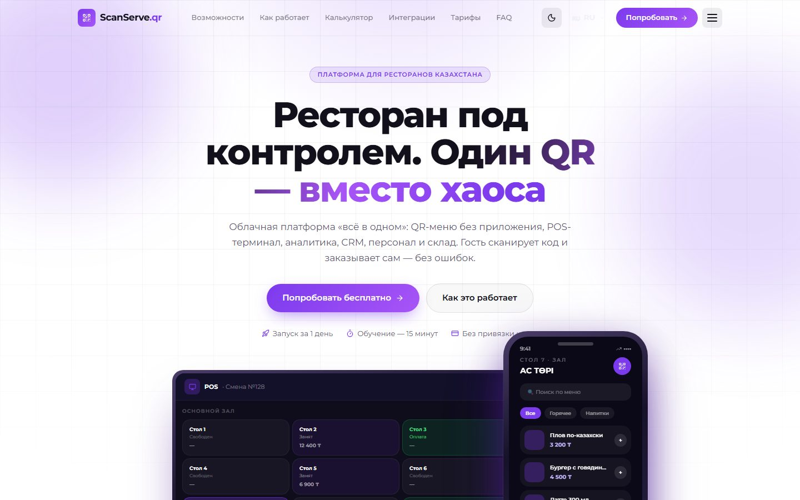
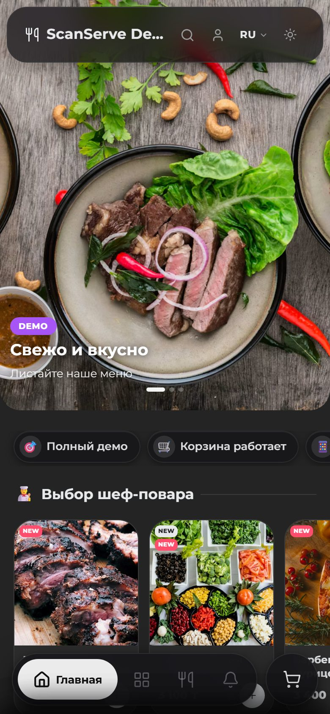

# ScanServe.qr — Restaurant Platform for Kazakhstan

Multi-tenant SaaS for restaurants: a guest scans the QR code on the table and orders from a branded mobile menu — no app to install. Behind the menu is a full back office: POS terminal with a live floor plan, staff shifts, CRM with push notifications, analytics, supplier invoices, network receipt printing and e-signatures.

**Live demo menu (no sign-up):** https://scanserve-qr-production-2cff.up.railway.app/demo  
**Landing page:** https://scanserve-qr-production-2cff.up.railway.app  
**In production:** «Ас Төрі» restaurant — https://scanserve-qr-production-2cff.up.railway.app/as-tori

<p>
  
  
</p>

**Stack:** Next.js 16 (App Router) · TypeScript · Supabase (PostgreSQL, Realtime, Storage) · Tailwind CSS v4 · shadcn/ui · Web Push · Railway

**Scale:** ~53k lines of TypeScript · 45 pages · 76 API routes · 71 SQL migrations · 680+ commits · UI in Kazakh, Russian and English

---

## Features

### Guest menu
- Branded menu per restaurant (`/[tenantSlug]`), light/dark theme, KZ / RU / EN
- Story-style hero slider, promo banners, chef's picks, popular dishes, likes
- Cart with dine-in / takeaway / delivery, pre-orders by date and time, dish modifiers and per-item notes
- Mixed payments, bank transfer details (Kaspi and others) with one-tap copy
- PDF receipt with Cyrillic, WhatsApp order hand-off, partial and full refunds
- Guest accounts with phone verification, order history, bonuses / cashback
- Call-a-waiter button

### Back office (`/admin`)
- **POS terminal** — live floor plan, table panel, pre-orders, waiter view; updates instantly via Supabase Realtime
- **Catalog & storefront** — dishes, categories, modifiers, stop-list / dish limits, banners, hero slider, recommendations, promotions
- **Staff** — role-based access, shifts, QR check-in with signed tokens, attendance
- **Analytics** — revenue, top dishes, order history, reviews; owner dashboard
- **Finance** — supplier invoices, warehouse, refunds, billing
- **CRM** — guest base, bonuses, Web Push campaigns (VAPID)
- **Printing** — ESC/POS receipts to LAN thermal printers
- **Documents** — e-signature on a phone via canvas, link-based access, signer IP recorded

### Super-admin
- Cross-restaurant view: restaurants, guest orders and transactions, advertising placements

---

## Architecture notes

- **All mutations go through API routes.** The browser never writes to Supabase directly; the service-role key lives only on the server.
- **Realtime** — `postgres_changes` subscriptions on `orders` and `restaurant_tables`, with polling fallback on the owner dashboard.
- **Two styling systems on purpose** — the guest menu uses inline styles + CSS variables so each tenant can be themed at runtime; the admin uses Tailwind + shadcn/ui for speed.
- **Mobile-first details** — `100dvh` for mobile browser chrome, pointer events for the signature canvas, scroll-snap sliders, no horizontal scroll anywhere.
- **Performance** — heavy admin modules are code-split with `next/dynamic`; dashboards fetch in parallel; optimistic UI for closing tables and marking orders paid.

```
src/
├── app/
│   ├── [tenantSlug]/   Guest menu for any restaurant
│   ├── demo/           Public interactive demo
│   ├── admin/          Back office (one folder per module)
│   ├── super-admin/    Cross-tenant management
│   ├── shared/sign/    Mobile e-signature page
│   └── api/            Route handlers: admin, guest, crm, orders, print, …
├── components/         MenuTemplate (guest), admin/* (back office)
├── lib/                Supabase clients, i18n, DB types
├── locales/            en / ru / kz
└── services/           Storage abstraction
supabase/               SQL migrations (run in Supabase SQL Editor)
docs/PROJECT_HISTORY.md Detailed module-by-module history (RU)
```

---

## Running locally

```bash
npm install
npm run dev          # http://localhost:3000
npx tsc --noEmit     # type check — required before every commit
```

Create `.env.local`:

```
NEXT_PUBLIC_SUPABASE_URL=
NEXT_PUBLIC_SUPABASE_ANON_KEY=
SUPABASE_SERVICE_ROLE_KEY=
NEXT_PUBLIC_RESTAURANT_ID=
NEXT_PUBLIC_APP_URL=
QR_CHECKIN_SECRET=
NEXT_PUBLIC_VAPID_PUBLIC_KEY=
VAPID_PRIVATE_KEY=
VAPID_EMAIL=
```

Database: apply the SQL files from `supabase/` in the Supabase SQL Editor.

## Deployment

Railway builds and deploys every push to `master`.
